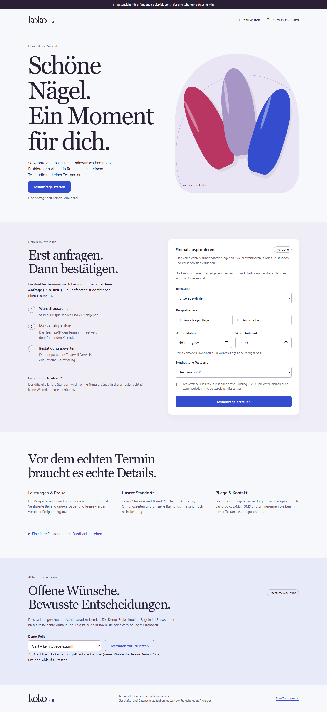
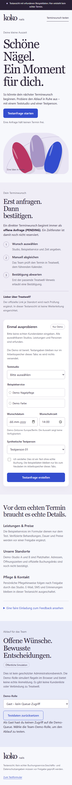
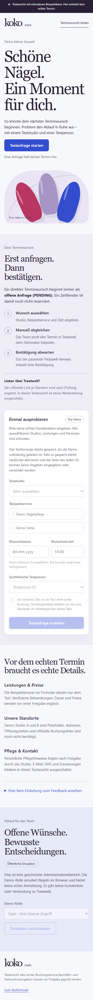

# Shareable synthetic review screenshots

Captured from implementation `46d80739572028a8007e9665799bcd7fe2a82db3` in isolated headless Chromium 156.0.8078.4 on 2026-10-27 UTC. The normal-flow run completed at `23:42:14.171Z`; the failure-path run completed at `23:41:57.453Z`.

The local QA worker and coordinator inspected these pixels. They are now tracked for independent review; this does not claim that the parent reviewer has inspected them. All content is synthetic. No real salon/customer data or browser chrome is captured.

- [Desktop, 1440px](desktop.png)
- [Mobile, 390px](mobile.png)
- [Mobile with app module failed: disabled controls and visible guidance](module-failure-mobile.png)

These documentation assets stay outside `dist/`; the six-file output manifest excludes them. They are evidence of a local prototype, not a deployed website.
